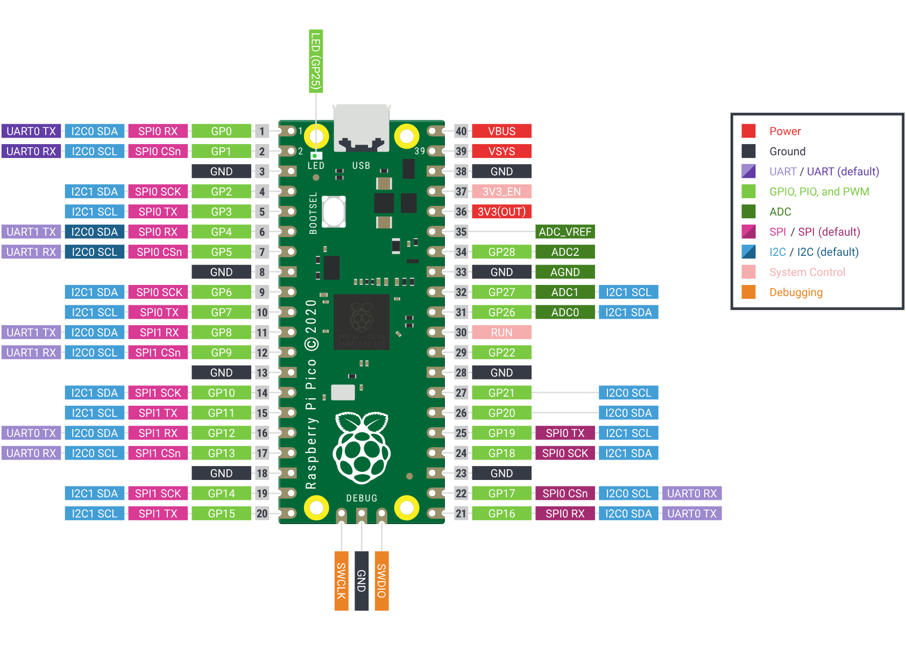
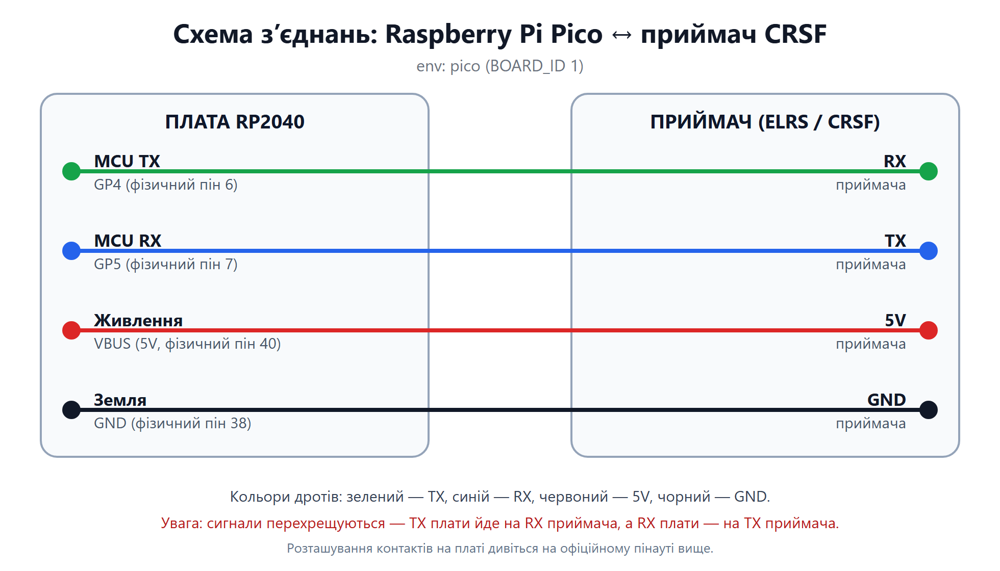
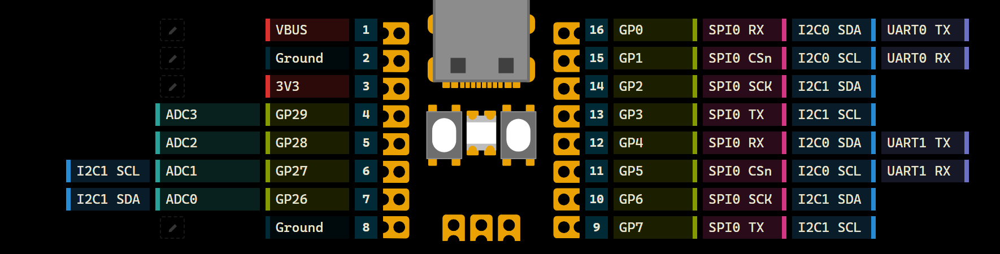
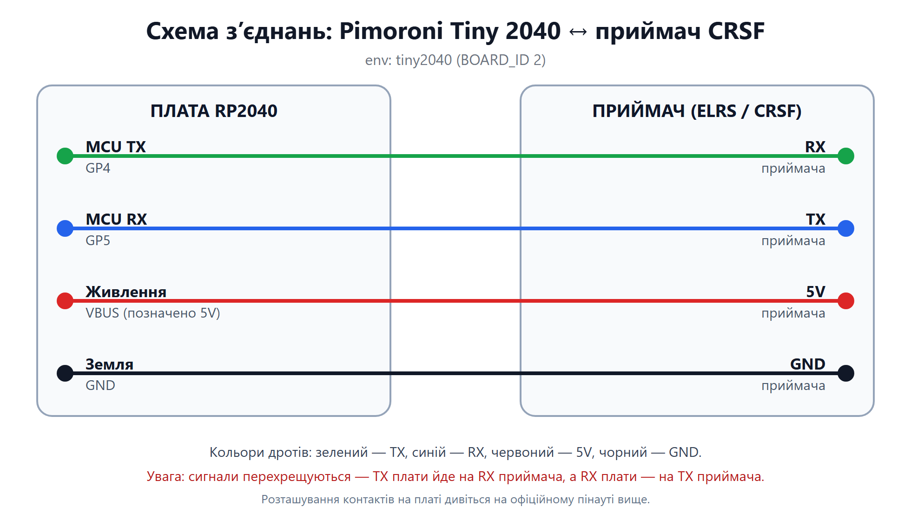
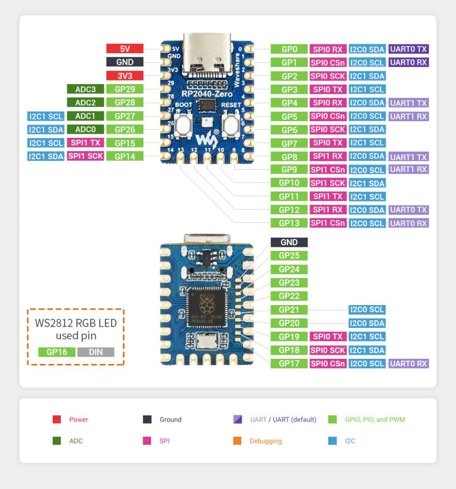
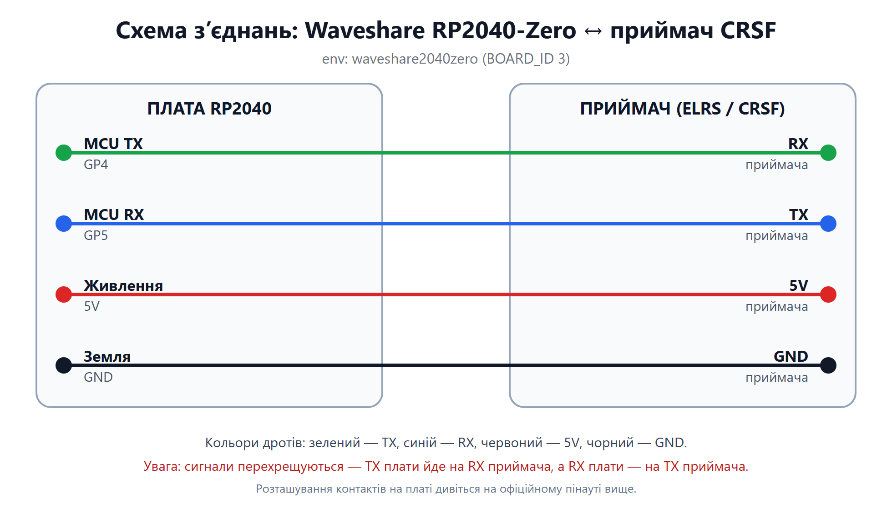
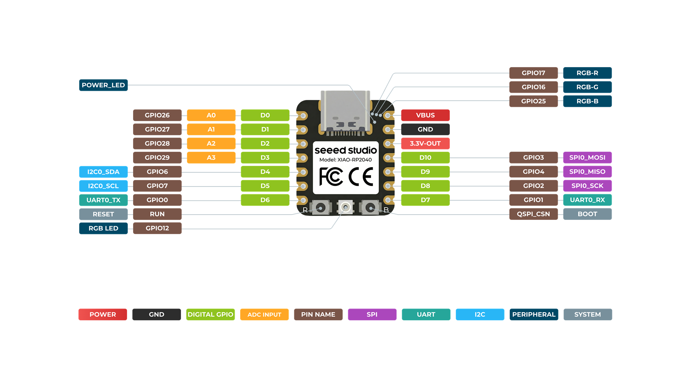
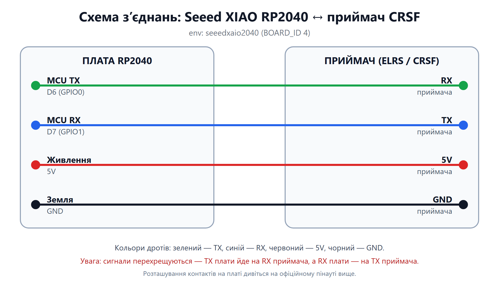
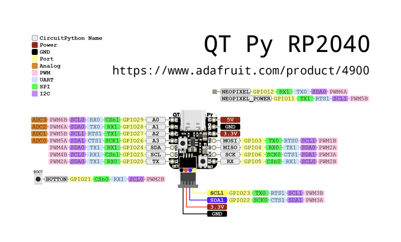
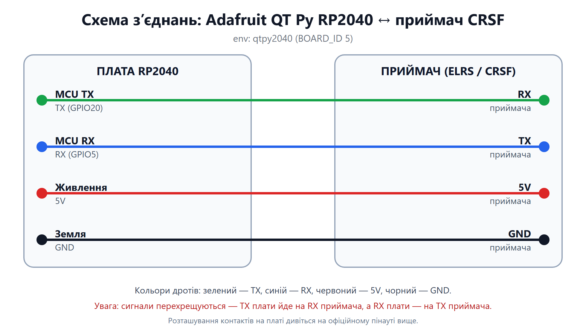

# Підключення приймача

Як підключити приймач CRSF (ELRS, TBS Crossfire, TBS Tracer) до кожної з
підтримуваних плат RP2040.

> ⚠️ Це форк проєкту
> [mikeneiderhauser/CRSFJoystick](https://github.com/mikeneiderhauser/CRSFJoystick),
> усі зміни внесені за допомогою ШІ. Пінаути та схеми наведені **довідково** —
> перед підключенням **обовʼязково перевіряйте пінаут своєї плати та полярність
> живлення самостійно**. Ви робите це на власний страх і ризик.

## Загальні нотатки

* **CRSF — це повнодуплексний UART.** Лінії перехрещуються:
  **MCU TX → RX приймача** та **MCU RX → TX приймача**. Не плутайте їх.
* **Живлення:** підключіть **5V** і **GND**. Приймачі ExpressLRS зазвичай
  працюють від 3.3–5 В; типово використовують 5 В (USB VBUS). Піна 3V3 теж
  підходить, якщо ваш приймач розрахований лише на 3.3 В.
* **Рівні логіки:** GPIO у RP2040 має рівень 3.3 В, а приймачі ELRS/CRSF — теж
  3.3 В логіка, тому сигнальні лінії зʼєднуються напряму, без перетворювача
  рівнів.
* Для CRSF потрібно лише три дроти: 5V, GND та по одній сигнальній лінії в
  кожному напрямку. Якщо у приймача лише один комбінований сигнальний дріт —
  звіртеся з документацією (зазвичай це інший протокол, не CRSF).
* Прошивка завжди працює на швидкості **115200 бод** на CRSF-UART
  (`CRSF_BAUDRATE`, див. `lib/CrsfSerial/crsf_protocol.h`).

Позначення:

* **MCU TX** — контакт передачі на платі RP2040.
* **MCU RX** — контакт приймання на платі RP2040.

## Як користуватися цією сторінкою

Для кожної плати наведено три речі:

1. **Офіційний пінаут** — як фізично виглядає плата і де який контакт.
2. **Схема зʼєднань** — який дріт куди йде (кольорова підказка).
3. **Таблиця** — який саме напис шукати на платі.

Рекомендовані кольори дротів (щоб не плутати):

| Дріт              | Колір           |
| ----------------- | --------------- |
| MCU TX            | 🟢 зелений       |
| MCU RX            | 🔵 синій         |
| 5V                | 🔴 червоний      |
| GND               | ⚫ чорний        |

---

## Raspberry Pi Pico — `pico` (BOARD_ID 1)

| Сигнал | Що шукати на платі          | Пін приймача | Дріт        |
| ------ | --------------------------- | ------------ | ----------- |
| MCU TX | `GP4` (фізичний пін 6)      | RX           | 🟢 зелений   |
| MCU RX | `GP5` (фізичний пін 7)      | TX           | 🔵 синій     |
| 5V     | `VBUS` (5V, фізичний пін 40)| 5V           | 🔴 червоний  |
| GND    | `GND` (фізичний пін 38)     | GND          | ⚫ чорний    |

Вбудований LED: `GP25` (звичайний).

Джерело пінаута: [Raspberry Pi — Pico documentation](https://www.raspberrypi.com/documentation/microcontrollers/pico-series.html).

## Pimoroni Tiny 2040 — `tiny2040` (BOARD_ID 2)

| Сигнал | Що шукати на платі  | Пін приймача | Дріт        |
| ------ | ------------------- | ------------ | ----------- |
| MCU TX | `GP4` (пад 12)      | RX           | 🟢 зелений   |
| MCU RX | `GP5` (пад 11)      | TX           | 🔵 синій     |
| 5V     | `VBUS` / `5V` (пад 1)| 5V          | 🔴 червоний  |
| GND    | `GND` (пад 2)       | GND          | ⚫ чорний    |

Вбудований LED: RGB на `GP18`/`GP19`/`GP20` (активний низький рівень).

Джерело пінаута: [pinout.xyz — Pimoroni Tiny 2040](https://pico.pinout.xyz/pimoroni-tiny-2040).

## Waveshare RP2040-Zero — `waveshare2040zero` (BOARD_ID 3)

| Сигнал | Що шукати на платі                        | Пін приймача | Дріт        |
| ------ | ----------------------------------------- | ------------ | ----------- |
| MCU TX | контакт з написом `4` (це `GP4`)          | RX           | 🟢 зелений   |
| MCU RX | контакт з написом `5` (це `GP5`)          | TX           | 🔵 синій     |
| 5V     | `5V`                                      | 5V           | 🔴 червоний  |
| GND    | `GND`                                     | GND          | ⚫ чорний    |

На шовкографії плати контакти GPIO підписані **номерами GPIO** (`0`…`15`,
`26`…`29`), а живлення — написами `5V`, `GND`, `3V3`.

Вбудований LED: WS2812 (NeoPixel) на `GP16`.

Джерело пінаута: [Waveshare Wiki — RP2040-Zero](https://www.waveshare.com/wiki/RP2040-Zero).

## Seeed XIAO RP2040 — `seeedxaio2040` (BOARD_ID 4)

| Сигнал | Що шукати на платі  | Пін приймача | Дріт        |
| ------ | ------------------- | ------------ | ----------- |
| MCU TX | `D6` (це `GPIO0`)   | RX           | 🟢 зелений   |
| MCU RX | `D7` (це `GPIO1`)   | TX           | 🔵 синій     |
| 5V     | `5V`                | 5V           | 🔴 червоний  |
| GND    | `GND`               | GND          | ⚫ чорний    |

Вбудований LED: WS2812 (NeoPixel) на `GP12`, живлення через `GP11`.

Джерело пінаута: [Seeed Studio Wiki — XIAO RP2040](https://wiki.seeedstudio.com/XIAO-RP2040/).

## Adafruit QT Py RP2040 — `qtpy2040` (BOARD_ID 5)

| Сигнал | Що шукати на платі    | Пін приймача | Дріт        |
| ------ | --------------------- | ------------ | ----------- |
| MCU TX | `TX` (це `GPIO20`)    | RX           | 🟢 зелений   |
| MCU RX | `RX` (це `GPIO5`)     | TX           | 🔵 синій     |
| 5V     | `5V`                  | 5V           | 🔴 червоний  |
| GND    | `GND`                 | GND          | ⚫ чорний    |

Вбудований LED: WS2812 (NeoPixel) на `GP12`, живлення через `GP11`.

Джерело пінаута: [Adafruit Learning System — QT Py RP2040](https://learn.adafruit.com/adafruit-qt-py-2040/pinouts).

---

## Як додати нову плату

1. Додайте секцію `[env:...]` у `platformio.ini` з
   `build_flags = -DBOARD_ID=<n>`.
2. Додайте відповідний блок у `include/board_defs.h`, визначивши `CRSF_TX`,
   `CRSF_RX` та функції `led_on()` / `led_off()` / `boardSetup()`.
3. Опишіть підключення в цьому файлі.
